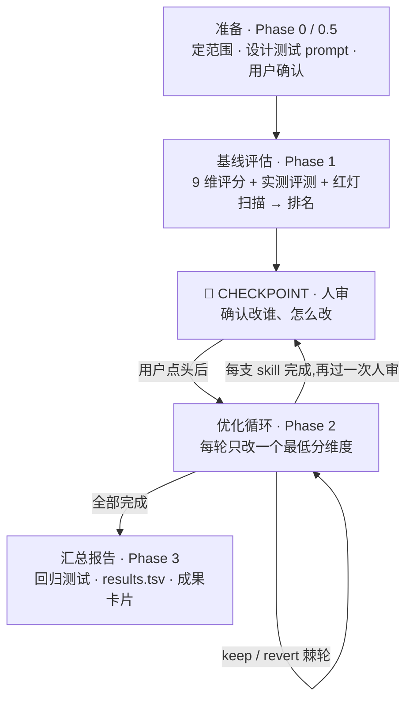

# 达尔文.skill 工作流程总结

> 一句话概括:**先给 skill 体检打分,再一圈圈「改一点、验一次」,只有盲评胜出的修改才保留。**

---

## 工作流程(五个阶段)

### 1. 准备(Phase 0 / 0.5)

确定要优化哪些 skill,为每个 skill 设计测试 prompt,经用户确认后开工。

### 2. 基线评估(Phase 1)

两条腿打分:静态读文档评 9 个维度(59 分)+ 独立 agent 实测跑测试 prompt(35 分),外加一次 runtime 红灯扫描。**分数只用来排「谁最弱、先改谁」(triage)**——详见下文评分卡。

### 3. 🔴 CHECKPOINT · 人审

展示评分卡(排名 + 短板),用户拍板优化范围和方式。

### 4. 优化循环(Phase 2)——核心引擎

- 每轮只改**一个最低分维度**,小步修改
- 改完 `git commit`,交给独立的 judge 做「改前 vs 改后」**paired 盲评**
- **胜出才 keep,落败立即 revert**(棘轮),如此往复直到连续两轮无明显提升(见好就收)
- 每支 skill 改完还要再过一次人审,确认后进入下一支
- 卡在局部最优时可选 **Phase 2.5 探索性重写**(推倒重写,必须征得用户同意)

### 5. 汇总(Phase 3)

回归测试确认无负迁移,记录 results.tsv,生成可视化成果卡片。

## 三道保险:分数只升不降

| 保险 | 作用 |
|---|---|
| 棘轮(keep/revert) | 改坏了就回滚,永远不会越改越差 |
| 独立盲评 | 改的人和评的人不是同一个上下文,避免自嗨 |
| 强制人审 | 三个 CHECKPOINT,LLM 判断不了的关键决策交给用户 |

---

## 附录:9 维评分卡(满分 100)

分三组,每组回答一个不同的问题。评分依据来自 SkillLens 论文(arXiv 2605.23899)的实证药方:LLM 自由评判 skill 质量准确率仅 46.4%(接近随机),按「失败编码 + 指令具体 + 反例黑名单」三维度评判后升至 73.8%,达尔文照方抓药并把这三维加权放大。

### 一、结构维度(59 分)——「文档本身写得对不对」,静态读一遍就能评

| # | 维度 | 权重 | 抓什么问题 |
|---|------|------|-----------|
| 1 | Frontmatter 质量 | 7 | name 规范、description 写清「做什么 + 何时用 + 触发词」;禁止“灵活应用”之类空话尾巴 |
| 2 | 工作流清晰度 | 12 | 步骤有序号、每步有明确输入/输出,照着能一步步执行 |
| 3 | 失败模式编码 | 12 | 必须写出「如果 X 失败 → Y」的分支;只写正向流程不写失败分支直接扣 ≥3 分 |
| 4 | 检查点设计 | 6 | 关键决策前有没有 `🔴/STOP/CHECKPOINT` 显性标记的人审点 |
| 5 | 可执行具体性 | 18 | **权重最高**。禁止“建议/可以考虑/视情况”等软化措辞,要有具体参数、格式、示例 |
| 6 | 资源整合度 | 4 | references/scripts 引用路径真实可达,不是摆设 |

### 二、效果维度(35 分)——「装上之后到底好不好用」,必须实测

| # | 维度 | 权重 | 抓什么问题 |
|---|------|------|-----------|
| 7 | 整体架构 | 12 | 层次是否清晰、有无冗余和 AI 腔废话(“说白了”“综上所述”) |
| 8 | **实测表现** | 23 | **全卡最重的一维**:拿测试 prompt 真跑一遍,输出质量是否兑现 skill 宣称的能力 |

### 三、Meta-skill 维度(6 分)——「会不会教 agent 避坑」

| # | 维度 | 权重 | 抓什么问题 |
|---|------|------|-----------|
| 9 | 反例与黑名单 | 6 | 必须有「不要做什么」清单;红灯动作/反模式单独成章 |

### 评分方式

- 每维打 1-10 分 × 权重求和:总分 = Σ(维度分 × 权重) / 10,满分 100
- ⚠️ **绝对总分只用于 triage(排「先改谁」),绝不用于 keep/revert**——换个 judge,同一份文档能摆 ±8 分
- 改动的 keep/revert 一律走 Phase 2 的 **paired 盲评**(同一把尺子量前后,误差相减抵销)

---

*本文件由达尔文 skill 会话中整理生成。详细规则见 [SKILL.md](SKILL.md),两篇理论基础论文总结见 [SkillLens-Paper-Summary.md](SkillLens-Paper-Summary.md) 与 [SkillOpt-Paper-Summary.md](SkillOpt-Paper-Summary.md)。*
